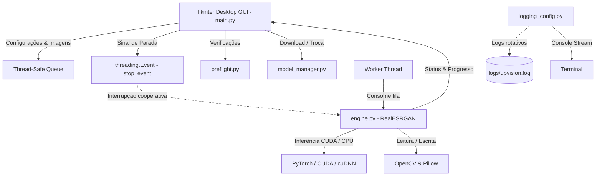

# Arquitetura — UpVision

Este é um resumo executivo da arquitetura do sistema UpVision. O detalhamento técnico aprofundado está disponível em [`docs/arquitetura.md`](docs/arquitetura.md) e em [`docs/modelos_ia.md`](docs/modelos_ia.md).

---

## 1. Visão Geral

O **UpVision** é uma aplicação desktop de inferência de visão computacional em borda (edge AI), desenhada para executar restauração e super-resolução de imagens em ambiente local sem dependência de serviços em nuvem.

---

## 2. Componentes Principais

- **Camada de Apresentação (`main.py`):** Interface gráfica desenvolvida sobre `tkinter`/`ttk`, responsável pelo controle de visualização, seleção de imagens, ajuste de parâmetros de escala (2x, 4x, 8x), visualizador de split antes/depois e feedback em tempo real.
- **Motor de Inferência (`engine.py`):** Implementação baseada em `RealESRGAN_x2plus` e `RealESRGAN_x4plus` sobre arquitetura `RRDBNet`, com suporte a cálculo em precisão mista FP16 (`half=True`) quando operando em GPU CUDA.
- **Gerenciador de Modelos (`model_manager.py`):** Módulo modal com controle de download sob demanda, verificação de existência e seleção rápida de checkpoints neurais.
- **Preflight Check (`preflight.py`):** Sistema de verificação de ambiente executado antes da renderização da interface, validando a integridade das bibliotecas de Deep Learning e periféricos de hardware.
- **Logging Estruturado (`logging_config.py`):** Logger unificado com `RotatingFileHandler` (5 MB, 3 backups) gravando em `logs/upvision.log` e mantendo stream no terminal.
- **Ferramental de Suporte (`tools/`):** Utilitários autônomos para download de checkpoints (`download_models.py`), diagnóstico de ambiente e GPU (`env_check.py`) e patches de compatibilidade (`patch_basicsr_torchvision.py`).

---

## 3. Fronteiras e Concorrência

1. **Desacoplamento de Threads:** A interface gráfica nunca executa inferência diretamente na thread principal (evitando travamento do loop de eventos do Tkinter). Todo processamento pesado roda em threads de trabalho dedicadas.
2. **Cancelamento Cooperativo:** O cancelamento de tarefas não realiza encerramento forçado de threads (`kill`). O motor verifica o estado de `stop_event.is_set()` a cada imagem e em pontos intermediários da inferência, encerrando com segurança e liberando memória VRAM.
3. **Isolamento de Dados:** Todo arquivo de entrada permanece na máquina local do operador; nenhum binário ou dado visual trafega por rede externa.

---

## 4. Invariantes do Sistema

- **Python Homologado:** Python 3.12 é a versão padrão mandatória para compatibilidade estável com o ecossistema `basicsr` e `realesrgan`.
- **Priorização de Hardware:** O sistema sempre detecta e prioriza aceleração NVIDIA CUDA quando disponível, provendo fallback gracioso para CPU.
- **Tamanho Mínimo de Checkpoint:** Arquivos `.pth` devem ter integridade mínima verificada (> 10 MB) para prevenir falhas de carregamento de pesos incompletos.
- **Documentação e Código:** Padrão linguístico rigorosamente mantido em Português Técnico (PT-BR).
