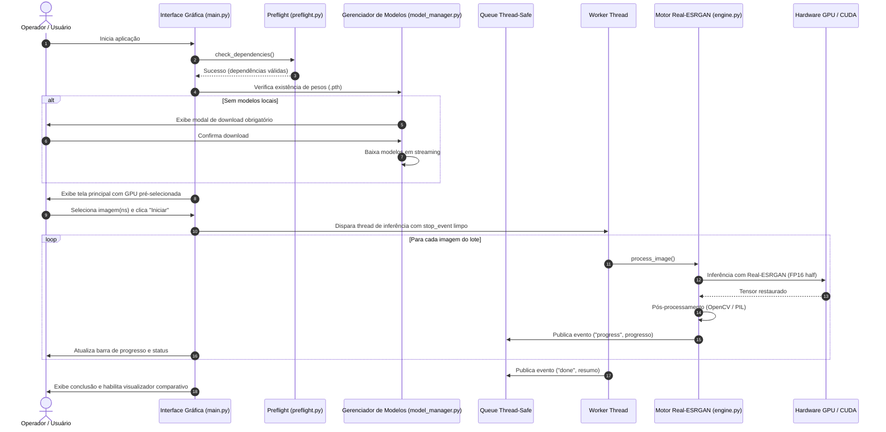

# Detalhamento de Arquitetura Técnica — UpVision

Este documento provê o detalhamento técnico e de engenharia de software da aplicação desktop **UpVision**.

---

## 1. Topologia Geral e Ciclo de Vida

O UpVision é arquitetado em três camadas lógicas estritamente desacopladas para assegurar responsividade da interface e eficiência máxima de computação gráfica:

---

## 2. Camadas do Sistema

### 2.1. Camada de Apresentação (Desktop GUI)
- **Arquivo Central:** [`main.py`](../main.py)
- **Tecnologia:** Python `tkinter` com extensão `ttk` e estilos personalizados.
- **Event Loop & Responsividade:** 
  - A interface nunca bloqueia. Todas as operações de I/O em lote ou inferência pesada são delegadas a instâncias de `threading.Thread`.
  - A comunicação entre worker threads e o loop Tkinter é mediada por uma fila thread-safe (`queue.Queue`).
  - O método `_poll_queue()` é agendado periodicamente via `self.root.after(100, self._poll_queue)` para descarregar mensagens pendentes e atualizar a interface na thread principal.
- **Visualizador Comparativo (Split View):**
  - Implementa slider interativo para divisão dinâmica entre a imagem original e o resultado upscalado.
  - Detecta automaticamente arquivos processados com base nos sufixos canônicos (`_sr`, `_x2`, `_x4`).

### 2.2. Motor de Inferência (Deep Learning Core)
- **Arquivo Central:** [`engine.py`](../engine.py)
- **Rede Neural:** `RealESRGAN_x2plus` e `RealESRGAN_x4plus` baseados na arquitetura `RRDBNet` (Residual-in-Residual Dense Block Network) com 23 blocos densos residuais.
- **Aceleração por Hardware:**
  - Detecção automática de dispositivos: `cuda` (NVIDIA) com fallback para `cpu`.
  - Otimização de precisão: Quando executado em CUDA, ativa automaticamente modo FP16 (`half=True`), reduzindo o consumo de memória VRAM em até 50% e acelerando a inferência sem perda perceptual de nitidez.
- **Cancelamento Cooperativo (`stop_event`):**
  - O método `process_batch` recebe uma instância de `threading.Event`.
  - A cada iteração sobre o lote de imagens, o motor verifica `stop_event.is_set()`.
  - Caso acionado pelo operador, o pipeline encerra graciosamente entre etapas, sem corrupção de imagens intermediárias e liberando os tensores de memória.

### 2.3. Sistema de Preflight e Diagnóstico
- **Arquivos:** [`preflight.py`](../preflight.py) e [`tools/env_check.py`](../tools/env_check.py)
- **Objetivo:** Garantir que o aplicativo nunca falhe de forma silenciosa ou crashe sem explicação ao operador.
- **Métricas Checadas:**
  - Presença de interpretador compatível (Python 3.12).
  - Status do pacote `torch` e driver NVIDIA CUDA.
  - VRAM total e disponível via `torch.cuda.mem_get_info()`.
  - Integridade das bibliotecas de Visão Computacional (`cv2`, `PIL`, `numpy`).
  - Aplicação dos patches de compatibilidade `basicsr` com versões modernas do `torchvision`.

### 2.4. Subsistema de Logging Estruturado
- **Arquivo:** [`logging_config.py`](../logging_config.py)
- **Destino dos Logs:** `logs/upvision.log`.
- **Estratégia de Rotação:** `RotatingFileHandler` dimensionado em 5 MB por arquivo, com retenção máxima de 3 arquivos de backup rotativos (`upvision.log.1`, etc.).
- **Formatação:** Formato unificado timestamped `%(asctime)s [%(levelname)s] %(name)s: %(message)s` com saída simultânea em console padrão para depuração em tempo de desenvolvimento.
